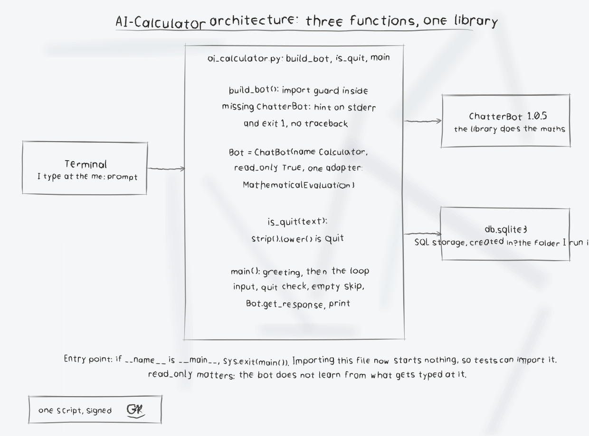

# AI-Calculator

**Drawn to Answer**
_Questions drafted in white line on blue, answered on the same sheet._


A terminal calculator chatbot in Python. It wraps ChatterBot with only its
MathematicalEvaluation logic adapter, in read-only mode, so you type a maths
question at the prompt and the bot answers in the same terminal. It does not
learn from your input.

<p align="center"></p>

<p class="plate"><sub>SHEET 1 · DRAWING OFFICE · chalk line &#10148;</sub></p>

## Requirements

- Python 3
- ChatterBot (see `requirements.txt`):

```bash
pip install -r requirements.txt
```

ChatterBot 1.0.5 is an old release with old pinned dependencies, so it is
best installed into its own virtual environment. On first use ChatterBot
also downloads NLTK data files, which needs network access. The bot stores
its data in a `db.sqlite3` file created in the directory you run it from.

<p align="center"></p>

<p class="plate"><sub>SHEET 2 · DRAWING OFFICE</sub></p>

## Run

```bash
python3 ai_calculator.py
```

Example session:

```text
Hello, I am a calculator. How may I help you?
me: what is 2 + 2?
Calculator: (the evaluated answer)
me: quit
Exiting
```

<p align="center"></p>

<p class="plate"><sub>SHEET 3 · DRAWING OFFICE</sub></p>

## Behaviour verified by testing

- Typing `quit` exits and prints `Exiting`. The match is case-insensitive
  and ignores surrounding spaces, so `QUIT` and ` quit ` also exit.
- Closing the input (EOF, for example Ctrl-D) or pressing Ctrl-C also exits
  cleanly with `Exiting` and status 0, with no traceback.
- Input the bot cannot evaluate gets the reply
  `Calculator: Please enter valid input.` and the loop continues.
- If ChatterBot is not installed, the program prints a short install hint
  to stderr and exits with status 1 instead of dumping a traceback.
- An empty line is skipped and prompts again instead of being sent to
  the adapter as a question.
- Tests: `python3 -m unittest` covers the quit matching and, on a
  machine without ChatterBot, the missing dependency path. The maths
  loop itself needs a working ChatterBot install; see Honest limits.

<p align="center"></p>

<p class="plate"><sub>SHEET 4 · DRAWING OFFICE</sub></p>

## Honest limits

<blockquote class="callout"><strong>NOTE FROM THE DRAWING BOARD</strong>: Treat the maths answering as provided by ChatterBot's MathematicalEvaluation adapter, not as something this repo re-implements.</blockquote>

During the improvement pass for this repo, the loop behaviour above was
verified with a real ChatterBot 1.0.5 install in a virtual environment.
A correct end-to-end maths answer was not re-verified in that environment:
ChatterBot's pinned dependencies are too old for a current Python 3.12
install without substitutions, and its NLTK corpus downloads were blocked
in the test sandbox, so every evaluation raised inside the library and the
script replied `Please enter valid input.` Treat the maths answering as
provided by ChatterBot's MathematicalEvaluation adapter, not as something
this repo re-implements.

<p align="center"></p>

<p class="plate"><sub>SHEET 5 · DRAWING OFFICE</sub></p>

## Files

- `ai_calculator.py` - the whole program
- `requirements.txt` - the ChatterBot dependency
- `LICENSE` - GNU General Public License v3

<p align="center"></p>

<p class="plate"><sub>SHEET 6 · DRAWING OFFICE</sub></p>

## Diagrams and maps

I drew the system out in [AI-Calculator-Visuals](AI-Calculator-Visuals/): an architecture diagram, a sequence diagram of one question, a flowchart of the loop in main(), a product map, and a statistics sheet, with the written product map, statistics with citations, and the roadmap in [VISUAL.md](AI-Calculator-Visuals/VISUAL.md). Every sheet also ships as a PNG photograph of the paper page beside its SVG.


